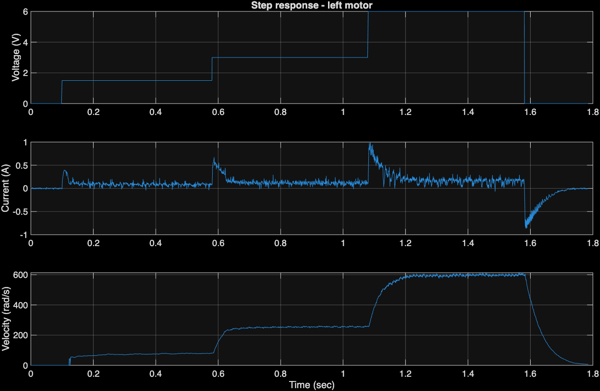
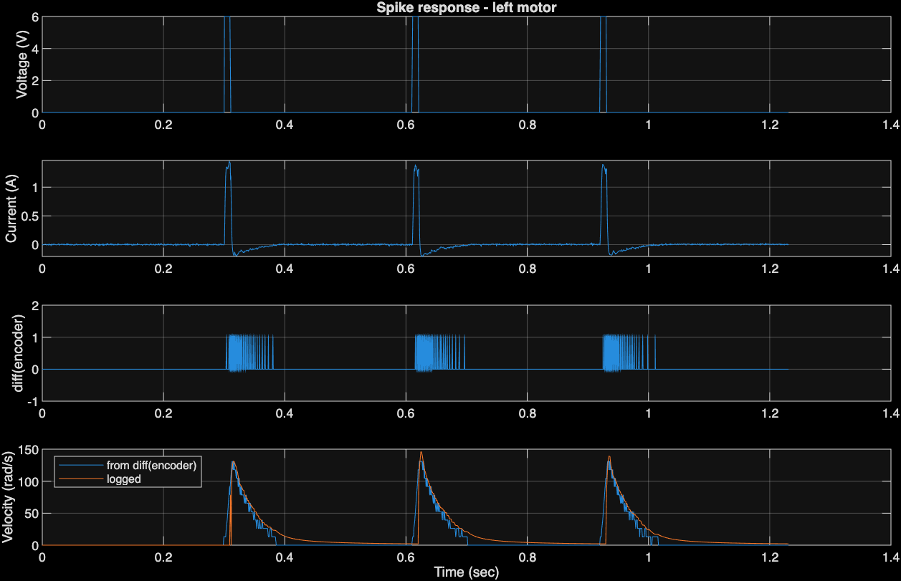
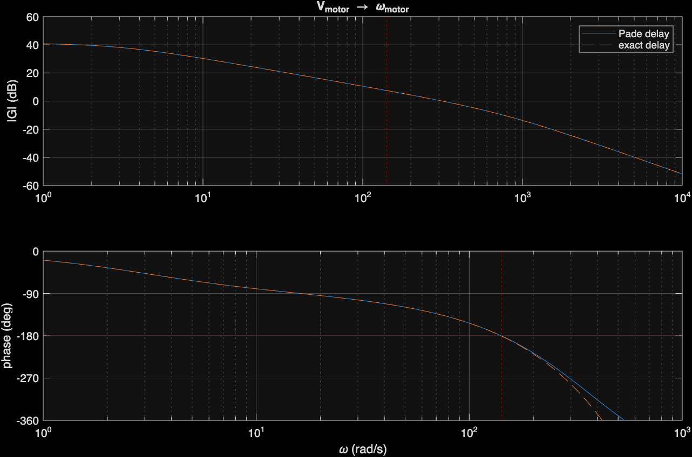
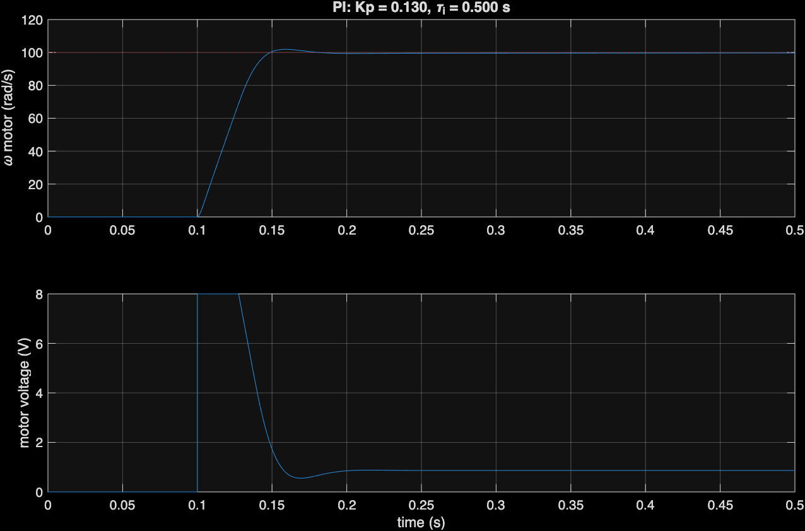
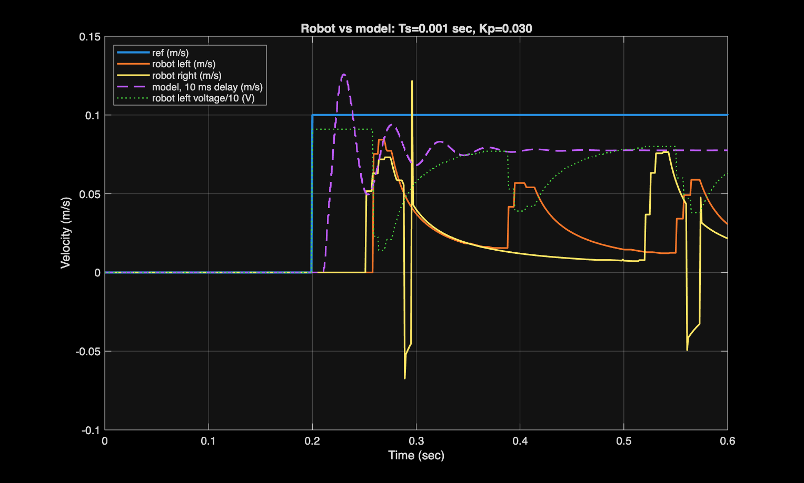
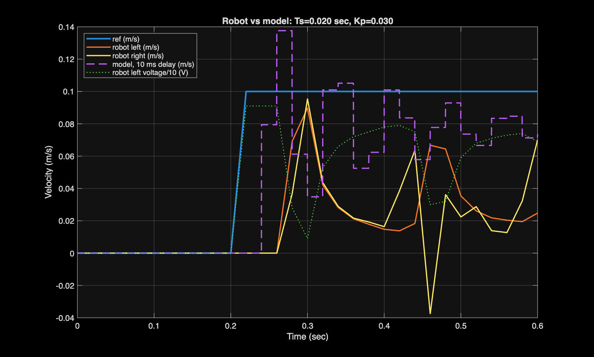

# Lecture 02 – Motor model, transfer function and PI design

Robot **Kim** (74), battery 12.3 V, **left motor**, wheels off the floor.
Sample time 500 µs, PWM 77 824 Hz.

| Log | Content |
|---|---|
| `logs/device-monitor-260917-114607.log` | step sequence (first run in file is used) |
| `logs/device-monitor-260917-120144.log` | spike sequence |

| Script | Does |
|---|---|
| `plotSteps.m` | step sequence plot + steady-state table |
| `plotSpikes.m` | spike sequence plot |
| `motorParams.m` | R, L, Kb, D, J from both logs → `motorParams.mat` |
| `transferFunction.m` | robot mass, delay, total TF, Bode plot, Q1, Q2 |
| `piDesign.m` | PI design, Simulink test (`motorPI.slx`) → `piDesign.mat` |

> **Why the left motor:** on Kim the right current channel reads about half the
> real current. It gives R = 9.1 Ω, while the class got 3–6 Ω (lecture 3 slide 2).
> The left channel gives R = 4.2 Ω and L = 5.6 mH, in line with the class
> (~4.5 mH). Kb comes from voltage and speed, so it is about the same for
> both motors (0.0081 / 0.0087).
>
> Earlier logs (robot Dicte, `260909-*`) are not used: the PWM frequency was an
> integer multiple of the sample rate, so the current was aliased, and Dicte's
> battery column read 5.2 V.

---

## 1. Robot model (ex robot mass)

### Step sequence (1.5 V, 3 V, 6 V, 0.5 s each)

Steady state (mean of the last 0.2 s of each step):

| V (commanded) | i (A) | ω (rad/s) |
|---|---|---|
| 1.5 | 0.084 | 77.7 |
| 3.0 | 0.114 | 255.3 |
| 6.0 | 0.153 | 597.5 |

### Spike sequence (3 × 6 V, 10 ms, 300 ms apart)

- The current rises with τₑ ≈ 1.3 ms (63.2 % point) to a stall current of **1.31 A**.
  diff(encoder) shows that the motor only starts moving after 2.5–5.5 ms (static friction).
- At 0 V the driver **brakes** (shorts the motor), so the current goes negative after
  each spike. Only driven samples are used.

### Model

- Electrical: V = R·i + L·di/dt + Kb·ω + V₀
- Mechanical: Kt·i = J·dω/dt + D·ω + T_c, with Kt = Kb

V is the **commanded** voltage (the firmware adds 0.4 V and compensates for a 1 V
driver loss). V₀ is the residual offset and T_c is Coulomb friction. Both are constant
offsets, not part of the linear model; the integrator in the controller removes them.

### Method (`motorParams.m`)

1. **R, Kb, V₀:** least squares on V = R·i + Kb·ω + V₀ over the three steady-state
   points and the stall point (ω = 0, i = 1.31 A at 6 V).
2. **D, T_c:** least squares on Kt·i = D·ω + T_c over the steady-state points.
3. **L** (lecture method): time to 63.2 % of the spike current, L = τₑ·R.
   Per spike: 5.93, 5.34, 5.51 mH. τₑ includes the current sensor's output
   filter (~0.29 ms), so L is slightly high.
4. **J** (lecture method): the dominant mechanical pole of the 3 V and 6 V steps
   (63 % rise, encoder velocity: 28.5 and 40.0 ms), J = τ_m·(Kt·Kb/R + D).

### Parameters

| Parameter | Value | Class (lecture 3) |
|---|---|---|
| R | **4.21 Ω** | 3–6 Ω |
| L | **5.6 mH** (τₑ = 1.33 ms) | ~4.5 mH |
| Kb = Kt | **0.0081 V/(rad/s) = Nm/A** | ~0.009 |
| J (motor, gear, wheel) | **5.7·10⁻⁷ kg·m²** (τ_m = 34 ms) | ~1·10⁻⁶ |
| D | **1.06·10⁻⁶ Nm/(rad/s)** | 0–3·10⁻⁶ |
| V₀ (offset) | 0.49 V | |
| T_c (Coulomb friction) | 6.2·10⁻⁴ Nm | |

---

## 2. Transfer function

### Effect of robot mass

Robot mass m = 0.95 kg (robots weigh 940–960 g; no scale available), wheel
radius r = 0.0315 m, gear 9.6 (firmware values).
Each wheel carries half the mass and moves at v = ω·r/gear. Equating kinetic energy,
½·(m/2)·v² = ½·J_r·ω²:

J_r = (m/2)·(r/gear)² = 0.475·(0.0315/9.6)² = **5.11·10⁻⁶ kg·m²**

J = J_motor + J_r = 0.57·10⁻⁶ + 5.11·10⁻⁶ = **5.69·10⁻⁶ kg·m²**

The robot mass is about 9× the motor inertia.

### Motor transfer function

G(s) = Kt / ((L·s + R)(J·s + D) + Kt·Kb)
     = 0.00812 / (3.18·10⁻⁸ s² + 2.40·10⁻⁵ s + 7.05·10⁻⁵)

- DC gain ≈ 115 (rad/s)/V
- Poles at ≈ 3 rad/s (mechanical, with robot mass) and ≈ 750 rad/s (electrical)

### Effect of measurement delay

A pure delay e^(−sT), T = 10 ms, is not rational. Usable approximation, 2nd order Padé
(as `pade(0.01, 2)` in the lecture):

G_delay(s) = (1 − sT/2 + (sT)²/12) / (1 + sT/2 + (sT)²/12)
           = (1 − 0.005 s + 8.33·10⁻⁶ s²) / (1 + 0.005 s + 8.33·10⁻⁶ s²)

Its gain is 1 at every frequency and it adds only phase lag, like the real delay.

### Total transfer function

G_tot(s) = G(s) · G_delay(s)

### Bode plot (motor voltage V → motor velocity rad/s)

**Question 1 – PI-frequency (phase = −180°):**
**ω₁₈₀ ≈ 141 rad/s (22.5 Hz)**

**Question 2 – Is a P-controller with Kp = 1 stable?**
**No.** |G_tot(jω₁₈₀)| = 2.37 > 1, gain margin −7.5 dB. Stable only for Kp < 0.42.

---

## 3. Controller design

### Design considerations

- **Steady-state error for a step?** With a P-controller, yes: the plant is type 0,
  so e_ss = 1/(1 + 115·Kp), about 6 % at Kp = 0.13. The V₀ and friction offsets
  add to that. A PI controller adds an integrator and removes the error.
- **Could a D or Lead term improve the response?** Only a little. The 10 ms delay
  limits the bandwidth, and a lead term can only recover part of that phase.
- **Noise:** the velocity is estimated from encoder edges (12 magnet dipoles,
  2 Hall sensors) and is coarsely quantized. A D or lead term raises the
  high-frequency gain and would amplify this noise straight into the motor voltage.
  → Plain PI.

### PI design

C(s) = Kp·(τᵢ·s + 1)/(τᵢ·s)

1. Target phase margin 60°, with the PI zero N = 3 times below the crossover (lecture).
   The PI zero costs atan(1/3) = 18.4° at ωc.
2. Crossover where ∠G_tot = −180° + 60° + 18.4° → **ωc ≈ 27 rad/s**.
3. **τᵢ = N/ωc = 0.11 s**
4. **Kp** from |C(jωc)·G_tot(jωc)| = 1 → **Kp = 0.077**

### Simulink test (`motorPI.slx`)

- New inertia J = 5.69·10⁻⁶ kg·m²
- Transport delay 10 ms on the measured velocity
- Saturation ±8 V on motor voltage and integrator
- Step at 0.1 s, final value 100 rad/s
- Simulation time 0.5 s

The design values give **14 % overshoot** and settle in 290 ms. With the robot mass
the plant is close to an integrator (pole at 3 rad/s), so a PI zero at ωc/3 adds
overshoot, and the 8 V saturation makes it worse. Sweep (1 s simulation):

| Kp | τᵢ (s) | Overshoot | Settling (2 %) | Phase margin | Gain margin |
|---|---|---|---|---|---|
| 0.077 (design) | 0.11 (design) | 14 % | 290 ms | 60° | |
| 0.13 | 0.05 | 49 % | 150 ms | 40° | 9.2 dB |
| 0.10 | 0.30 | 1.9 % | 56 ms | 67° | 12.4 dB |
| 0.10 | 0.50 | 0 % | 85 ms | 70° | 12.4 dB |
| **0.13** | **0.50** | **1.9 %** | **45 ms** | **63°** | **10.2 dB** |
| 0.16 | 0.50 | 6.5 % | 72 ms | 56° | 8.4 dB |
| 0.20 | 0.50 | 11 % | 71 ms | 47° | 6.4 dB |

### Final values

**Kp = 0.13 V/(rad/s), τᵢ = 0.5 s**

- Crossover 44 rad/s, phase margin 63°, gain margin 10.2 dB
- Rise time (10–90 %) 33 ms. The voltage is at the 8 V limit for the first 28 ms,
  then settles at 0.87 V.

Saved in `piDesign.mat` (R, L, K, Jm, Jr, J, D, T, num, den, pn, pd, PM, Ni, wc,
KpDesign, tau_iDesign, Kp, tau_i, Vmax) for the discrete-time extension.

---

# Lecture 05 – Sampling time

P-controller, **Kp = 0.03 V/(rad/s)**, wheels up, step 0 → 0.1 m/s at t = 0.2 s.
Model: `samplingModel.m` (`basebot_model_sampling.slx`, ZOH on both sides, 10 ms
measurement delay). Robot vs model: `compareRobot.m`, logs `logs/pstep_Kp003_Ts*.log`.

| Ts | Peak (m/s) | Settled (2 %) |
|---|---|---|
| 1 ms | 0.126 | ≈ 0.18 s after the step |
| 5 ms | 0.136 | ≈ 0.3 s |
| 10 ms | 0.149 | no, still oscillating at 0.6 s |
| 20 ms | 0.138 | no, large swings (down to 0.035 m/s) |

### Effect of sampling time

Sampling faster is like a higher refresh rate: the controller gets new information
more often and can react before the speed overshoots. At Ts = 1 ms the model
overshoots to 0.126 m/s and settles within about 0.18 s. As Ts grows, the overshoot
gets bigger and the oscillations take longer to die out; at 10 and 20 ms the response
is still oscillating after 0.4 s.

This is because the controller holds its output between samples (ZOH), so it acts on
older information. The hold works like an extra delay of about Ts/2 on top of the
10 ms measurement delay, and more delay means more overshoot and eventually
instability. With Kp = 0.05 the model is already unstable at Ts = 1 ms
(`figures/sampling_time_1ms_step.png`).

**Longest sample time with a decent result (model): ≈ 5 ms.**

### Steady-state error

All responses settle at about 0.078 m/s instead of 0.1 m/s. A P-controller only
produces voltage when there is an error, so it needs some remaining error to keep
the motor running. Section 3 predicts this: e_ss = 1/(1 + 115·Kp) = 1/(1 + 115·0.03)
= 22 % → 0.078 m/s. An integrator (PI) would remove it.

### Robot vs model (step 10: are the effects the same?)

Not really. The model settles smoothly, but the real wheels **stick and slip**: the
speed dies out towards zero, the P-controller raises the voltage (larger error →
more voltage), and at about 0.8 V the wheel breaks free and jumps forward, like a
car escaping from mud. Near the target the error is small again, the voltage drops,
the wheel slows down, and the cycle repeats.

The cause is friction, which the linear model leaves out (section 1: V₀ = 0.49 V
and T_c = 6.2·10⁻⁴ Nm, i.e. R·T_c/Kt ≈ 0.32 V). Together the motor needs
≈ 0.8 V just to keep turning, which matches the jump in the plots. The model thinks
0.21 V is enough to hold 0.078 m/s (23.8 rad/s / 115). With Kp = 0.03 the controller
only produces 0.8 V when the wheel has almost stopped, so it can never hold a steady
speed. Static friction (it takes more to start than to keep moving) makes each
breakaway a jump.

Because friction dominates at 0.1 m/s, the effect of Ts is hard to see on the robot.
A cleaner comparison would use a higher reference speed or the PI controller, whose
integrator keeps raising the voltage until the friction is overcome.
